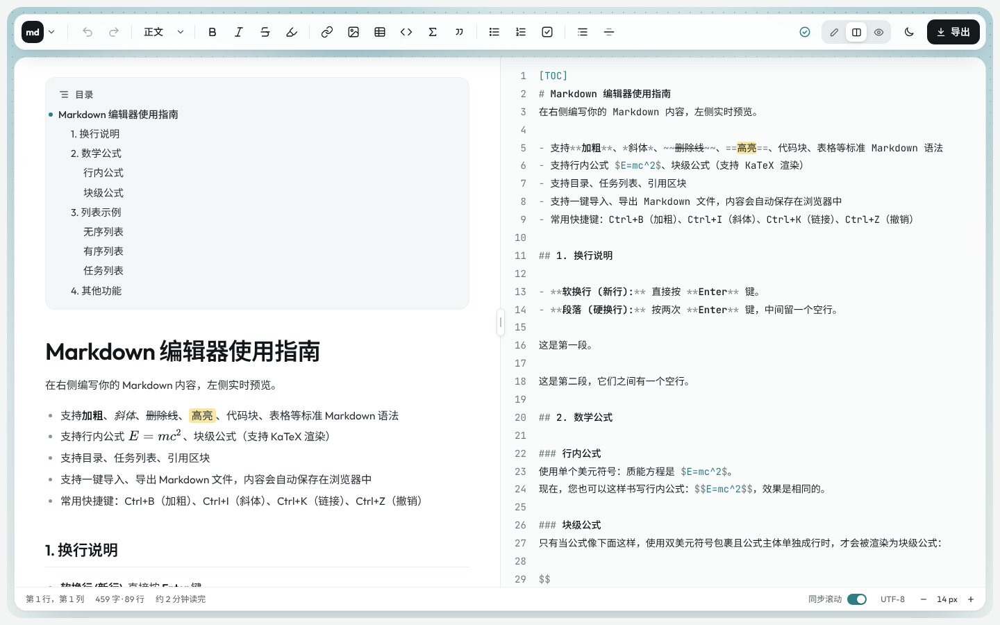

# Online Markdown Editor

A lightweight Markdown editor that runs entirely in the browser. Write in live mode, where the block you are editing shows its Markdown and everything else stays rendered, or use the source, split and preview views. Math, code highlighting and a table of contents are built in. There is no build step and no server: open `index.html` and start writing.



## Features

**Live mode (实时)**
- The document is shown rendered; the block the caret is in shows its Markdown markers, keeping its size, weight and colour, and is rendered again as soon as the caret leaves it
- Click a block to edit it there; the arrow keys move between blocks. Enter starts a new paragraph (or continues a list or quote), Shift+Enter adds a line break, Esc stops editing
- Code blocks are edited in a code editor with line numbers and an editable language; formula blocks show a live preview under their LaTeX, and an inline formula shows one while the caret is in it
- Click a task's checkbox to tick it; Ctrl/⌘-click a link to open it
- Typing `` ``` `` or `$$` on a line of its own and pressing Enter creates a code or formula block
- 打字机 (typewriter) keeps the caret line in the middle of the screen; 专注 (focus) fades every block but the one being edited
- Fast on long documents: only the edited block is re-rendered, rendered blocks are cached, and off-screen blocks skip layout

**Source editing**
- Editor with line numbers, Markdown syntax highlighting and current-line highlight
- A two-row top bar: the logo opens the file menu (new, import, export), then the outline switch and the document's name, the command palette, the save state, view modes, typography settings, theme and export; the formatting tools are on the second row
- Formatting tools: undo/redo, paragraph style (H1–H6), bold, italic, strikethrough, highlight, links, images, tables, code blocks, formulas, quotes, lists, task lists, table of contents, horizontal rules
- On narrow windows the trailing tool groups move into a **⋯** (more) menu
- Table picker (up to 6 × 8, with column alignment) and a link/image dialog
- Toolbar and menus are fully usable from the keyboard

**Preview**
- Math via KaTeX, code blocks via highlight.js (with line numbers and a copy button); both are downloaded only once a document contains a formula or a code block
- `[TOC]` table of contents that marks the section you are reading
- Synchronised scrolling between preview and source, anchored on headings

**Workspace**
- Live, source, split and preview views, with a draggable divider in the split view
- An outline of the document's headings beside it, marking the section being edited (or read); click a heading to go to it
- A command palette (`Ctrl+Shift+P`) with every command, found by its Chinese or English name or by pinyin
- Typography settings: page width (presets, a slider, or drag the page's edges), Latin, Chinese and code fonts, and line spacing. A font is downloaded only once chosen; the settings are kept in the browser
- Light and dark themes; the status bar holds the block type (in live mode), the caret position, word and line count, reading time, the typewriter, focus and sync-scroll switches and the font size
- Autosave in the browser, plus import and export of `.md` files. The save indicator next to the view switch names its state in its tooltip and stays expanded if saving fails

## Markdown extras

| Syntax | Result |
|:--|:--|
| `==text==` | Highlighted text |
| `$E=mc^2$` or `$$E=mc^2$$` on one line | Inline formula |
| `$$` on its own lines around a formula | Block formula |
| `[TOC]` on its own line | Table of contents |
| `- [ ]` / `- [x]` | Task list |

Standard GitHub-flavoured Markdown (tables, fenced code, strikethrough, autolinks) works as usual. A single line break is kept as a line break.

## Keyboard shortcuts

| Action | Windows / Linux | macOS |
|:--|:--|:--|
| Bold | `Ctrl+B` | `⌘B` |
| Italic | `Ctrl+I` | `⌘I` |
| Insert link | `Ctrl+K` | `⌘K` |
| Undo | `Ctrl+Z` | `⌘Z` |
| Redo | `Ctrl+Y` or `Ctrl+Shift+Z` | `⌘⇧Z` |
| Command palette | `Ctrl+Shift+P` | `⌘⇧P` |

## Getting started

Open `index.html` in a modern browser (Chrome, Edge, Firefox or Safari). To serve it instead, any static server works:

```bash
python3 -m http.server 8000
# then visit http://localhost:8000
```

To deploy it, upload the folder to any static host (GitHub Pages, Netlify, Vercel, IPFS, etc.).

Libraries (marked, highlight.js, KaTeX) and fonts load from CDNs, so the first visit needs an internet connection. highlight.js and KaTeX are fetched the first time a document needs them; offline, code shows unhighlighted and formulas as their TeX source.

## Working on the code

Clone the repository rather than downloading a ZIP, so your edits can be committed and pushed back:

```bash
git clone https://github.com/AntlerPotato/Online-Markdown-Editor.git
cd Online-Markdown-Editor
```

If you prefer not to use the command line, GitHub Desktop's **File › Clone repository** does the same.

There is nothing to install or build: edit the files, refresh the browser, then commit. A few files keep everyone's setup consistent:

- `.gitattributes` stores text files with LF line endings on every platform, so editing on Windows doesn't mark every line as changed
- `.editorconfig` tells most editors to use UTF-8, LF and 4-space indentation, matching the existing code (VS Code needs the EditorConfig extension)
- `.gitignore` keeps OS and editor clutter (`.DS_Store`, `Thumbs.db`, `.vscode/`, `.idea/`, …) out of commits

## Your data

Documents are autosaved to your browser's `localStorage`. They never leave your device and are not synced anywhere. Clearing site data or using a private window removes them, so use **导出** (Export) to keep a `.md` copy of anything important.

## Project structure

```
index.html              App markup: top bar, toolbar, panes, status bar, popovers
assets/
  css/
    tokens.css          Design tokens (colours, fonts, radii, shadows), light and dark
    base.css            Reset and shared controls (buttons, segmented control, inputs)
    layout.css          App shell: stage, top bar, toolbar, save state, card, panes, splitter, status bar
    menus.css           Menus (file, paragraph style, more tools), table picker, link dialog
    editor.css          Source editor (transparent textarea over a highlighted backdrop)
    preview.css         Rendered Markdown, code theme, KaTeX tweaks
    live.css            Live mode: blocks, the block being edited, code and formula editors
  js/
    store.js            Safe localStorage wrapper (settings and autosave)
    sample.js           Document shown on first visit
    loader.js           Loads highlight.js and KaTeX on first use
    markdown.js         Markdown → HTML (marked renderer, math, TOC)
    syntax.js           Markdown syntax highlighting for the editor
    editor.js           Editor component: backdrop, caret tracking, undo/redo; holds the document for every view
    live.js             Live mode: splits the document into blocks, caches their HTML, edits one block at a time
    commands.js         Formatting commands (wrap, headings, lists, tables, links)
    popover.js          Menu and popover positioning and keyboard handling
    app.js              Wires everything together (including the toolbar overflow)
docs/
  screenshot.png
.gitattributes          Line endings (LF) and binary file rules
.editorconfig           Shared editor settings
.gitignore              Files kept out of the repository
```

## License

Licensed under the Apache License 2.0. See [LICENSE](LICENSE).
